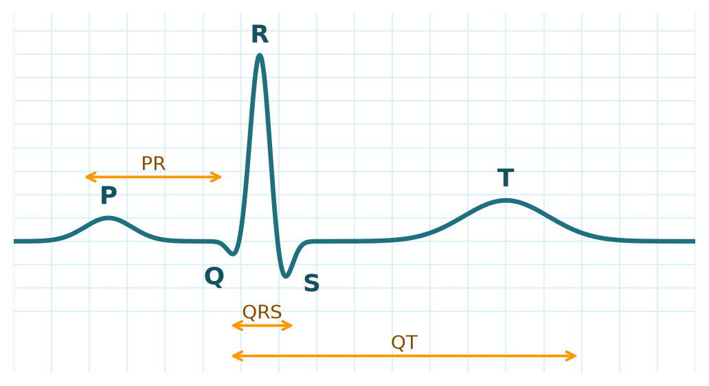
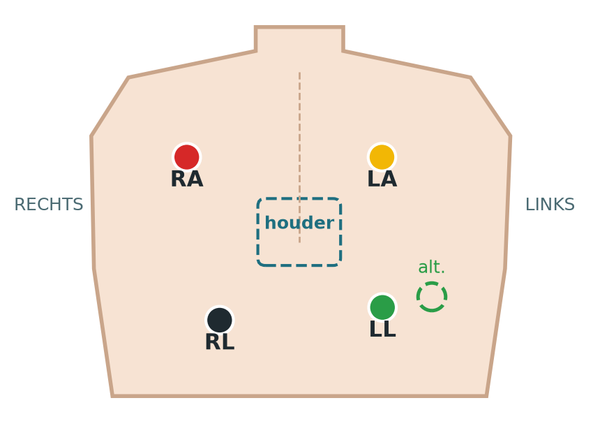
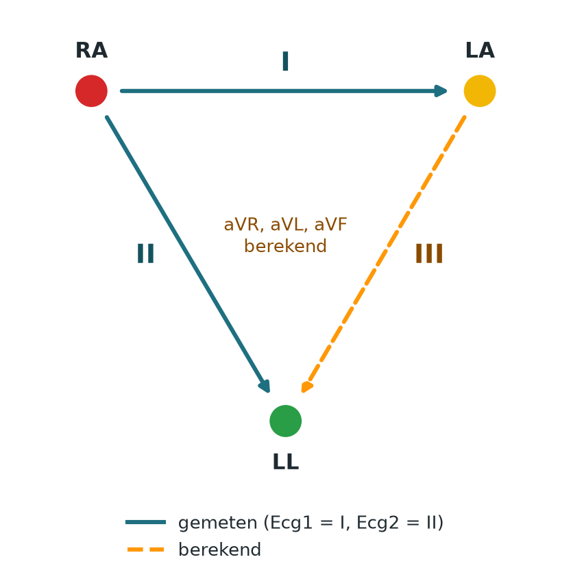

# pcardio-ecg-tool

App van AppBakkers voor P-Cardio-opnames: deelnemers en opnames beheren, live annoteren, live ECG/acc/gyro via de
dongle, P-Cardio-data koppelen, bekijken & annoteren en exporteren. Er zijn twee versies op dezelfde data:

- **Desktop-app** (`desktop/`, PySide6 + pyqtgraph): live plots zonder geflikker, knoppen reageren direct.
  Dubbelklik **`ECG-tool.cmd`**.
- **Streamlit-app** (`streamlit/`): dezelfde functies in de browser. Uitleg over de app en de code staat in
  [streamlit/README.md](streamlit/README.md).

**Data:** `streamlit/data/ecg.db` (SQLite: deelnemers, opnames, annotaties) en per opname een map met de ruwe
bestanden, signalen (parquet) en exports. Het oudere formaat (`deelnemers.csv`, `opname.json`, `annotaties.csv`)
wordt bij de eerste start eenmalig overgenomen; die bestanden blijven staan maar worden daarna niet meer gebruikt.

## Installeren (eenmalig, Windows)

Vereist **Python 3.12.x** (met de Python Launcher `py`). Dubbelklik `init_repo.cmd` of voer het uit in cmd. Het
script maakt `.venv` aan met Python 3.12 en installeert `requirements.txt`.

## Starten

**Desktop-app:** dubbelklik `ECG-tool.cmd`, of `.venv\Scripts\python desktop\app.py`.

**Streamlit-app:** altijd vanuit de projectroot, anders wordt `.streamlit/config.toml` niet geladen:

```powershell
.venv\Scripts\Activate.ps1
streamlit run streamlit\app.py
```

Krijg je `UnauthorizedAccess` bij het activeren? Voer eenmalig uit:
`Set-ExecutionPolicy -Scope CurrentUser -ExecutionPolicy RemoteSigned`.

## Mappen

| Map | Inhoud |
|---|---|
| `desktop/` | desktop-app: `app.py` (hoofdvenster), `beheer.py`, `live.py`, `analyse.py` |
| `streamlit/` | Streamlit-app: pagina's, `kern/` (logica zonder UI, ook gebruikt door de desktop-app), tests |
| `scripts/probe_device.py` | losse hardwaretest van dongle en recorder, buiten de app om |
| `docs/` | [opnameprotocol](docs/opnameprotocol-p-cardio.md) en handleidingen van de P-Cardio |
| `mobiel/` | web-app voor de telefoon: annoteren zonder pc, bijv. in de sportschool (zie hieronder) |

## Annoteren op je telefoon

`mobiel/` is een web-app voor perioden, momenten en sync-sprongen zonder pc. Hij werkt offline. GitHub Pages host
hem op <https://esmeek1.github.io/pcardio-ecg-tool/mobiel/> (Settings → Pages → branch `main`, map `/ (root)`).

1. Open de link op de iPhone in Safari: Deel-knop → **Zet op beginscherm**.
2. Na de sessie: **Exporteer CSV** → stuur hem naar jezelf.
3. Op de pc: pagina **Data koppelen** → lees de CSV in → **Nieuwe opname**: kies de deelnemer en vul de gegevens
   in (zelfde standaardwaarden als bij Live opname) → **Koppel**.
4. Zet de P-Cardio in de docking en lees de P-Cardio-bestanden in. De app stelt de opname van stap 3 voor →
   **Koppel**, en bepaal daarna de klokcorrectie met de sync-sprong.

De tijden komen van de telefoonklok (`tijdbasis` = `pc`), dus doe een sync-sprong in de app. Test:
`streamlit/tests/test_mobiel.py` (vereist `node`).

`mobiel/live.html` toont live ECG, acc en gyro via de Bluetooth van de telefoon, zonder dongle (alleen kijken). Safari
kan geen Bluetooth: open de pagina op de iPhone in de gratis app **Bluefy**. Op Android en de pc werkt Chrome/Edge.

`streamlit/data/` bevat deelnemers- en opnamegegevens en staat in `.gitignore`. Uitzondering: de oefendata
in `streamlit/data/test/` gaat wel mee, zodat je meteen een oefenopname kunt maken.

## Medische achtergrond: ECG in het kort

Basiskennis om te begrijpen wat de app laat zien. Geen medisch advies: de app stelt geen diagnoses. Bron:
*Use-cases en requirements Secu-Sense WP4*.

### Eén hartslag

Een **ECG** (elektrocardiogram) registreert de elektrische activiteit van het hart via elektroden op de huid.
Eén hartslag bestaat uit vaste golven:

- **P**: de boezems trekken samen.
- **QRS**: de kamers trekken samen. De hoge, scherpe piek heet de **R-top**; die gebruik je om hartslagen te
  vinden en uit te lijnen.
- **T**: de kamers herstellen.



### De plakkers (elektroden)

De P-Cardio gebruikt vier plakkers met gel. Zie ook het [opnameprotocol](docs/opnameprotocol-p-cardio.md).

| Plakker | Kleur | Rol |
|---|---|---|
| RA | rood | meet mee in lead I en II |
| LA | geel | meet mee in lead I |
| LL | groen | meet mee in lead II (gestippeld: alternatieve plek) |
| RL | zwart | referentie: onderdrukt ruis, maakt zelf geen lead |



### Kanalen, leads en Einthoven

Een **kanaal** is het spanningsverschil tussen twee plakkers. Een **afleiding (lead)** is een vaste
"blikrichting" op het hart. De P-Cardio meet twee kanalen:

- **Ecg1 = lead I** = LA − RA
- **Ecg2 = lead II** = LL − RA

Met de **wetten van Einthoven** rekent de app daaruit vier extra leads uit, samen 6 leads:

| Lead | Berekening |
|---|---|
| III | II − I |
| aVR | −(I + II) / 2 |
| aVL | I − II / 2 |
| aVF | II − I / 2 |

De berekende leads bevatten geen nieuwe informatie, alleen een andere blikrichting.



### Begrippen

| Begrip | Uitleg |
|---|---|
| Lead-off | Melding van de P-Cardio dat een draad los is. Ziet een losgepelde plakker **niet**: controleer zelf het contact. |
| Artefact | Verstoring in het ECG die niet van het hart komt, bijvoorbeeld door beweging of slecht contact. |
| Signaalkwaliteit (SQI) | Maat voor hoe bruikbaar een stuk ECG is, bijvoorbeeld het aandeel herkenbare hartslagen. |
| Accelerometer / gyroscoop | Bewegingssensoren in de P-Cardio: versnelling (g) en draaiing (graden/s), elk in drie richtingen. Verklaren vaak waarom een signaal slechter is. |
| BLE | Bluetooth Low Energy: draadloze verbinding tussen de P-Cardio en de tablet/pc. |
